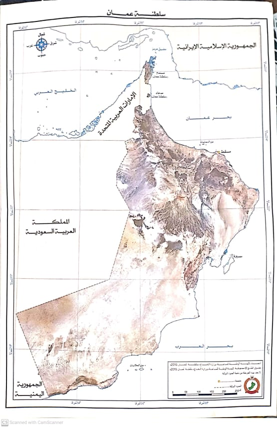
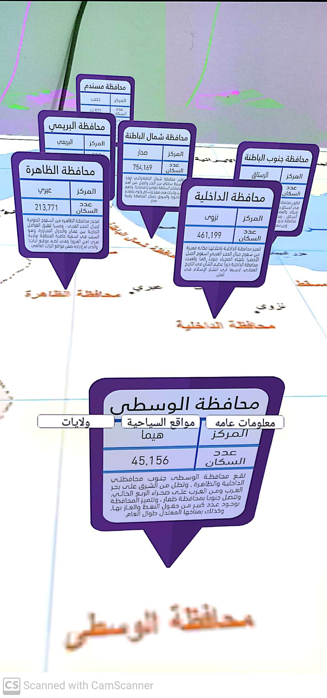
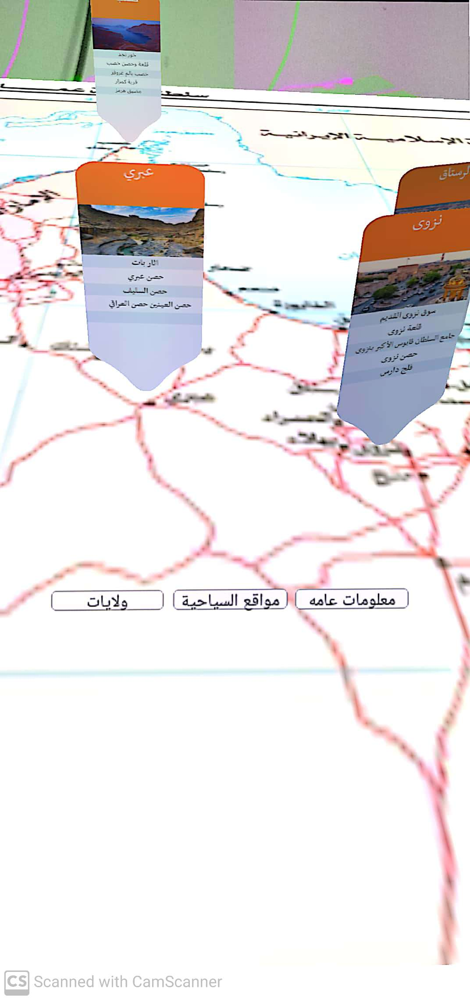
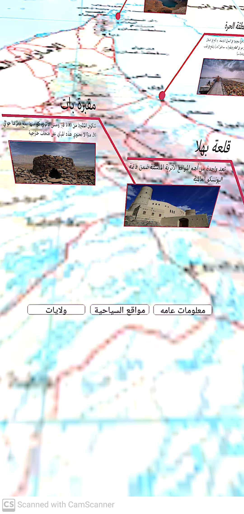

# DuniaLab

**Printed, curriculum-mapped learning maps that come alive on any Android phone.** Each mission ends with the child
explaining what they learned, and a mastery report a parent or teacher can trust. *AR is the hook. The learning loop is the product.*

First product: **Kenya Explorer**, Kenya Grade 5 Social Studies, Strand 1 (Elements of a map; Main physical features in Kenya).

| | |
|---|---|
| 📘 Learn the system | [docs/technical-guide.md](docs/technical-guide.md) |
| 🗺️ Architecture (living diagrams) | [docs/architecture/](docs/architecture/README.md) |
| 🧭 Decisions | [docs/adr/](docs/adr/README.md) |
| ✅ How we build (Feature → Unit → E2E) | [docs/engineering/testing-workflow.md](docs/engineering/testing-workflow.md) |
| 📄 Product definition | [docs/product/](docs/product/) |

## Quick start

```bash
npm install && npm run build
npm test                 # feature + unit tests
npm run db:up            # Postgres (Docker)
npx playwright install chromium   # first time only, for the browser E2E
npm run test:e2e         # API + Postgres + browser end-to-end
npm run dev:api          # http://localhost:3000
npm run dev:web          # http://localhost:5173  (Tier C 2D map)
```

## Repository

```
packages/   content (packs, schema, rubric checker) · mastery (rules, review) · mission (session flow)
apps/       api (NestJS + Postgres) · web (React, Tier C) · unity (Unity 6 LTS, Tiers A/B)
tests/      features (acceptance, written first) · e2e (real system)
docs/       technical guide · architecture · ADRs · product
legacy/     Oman Maps (2019), archived
```

## Origin: Oman Maps (2019)

DuniaLab grew out of **Oman Maps**, an AR app (Unity + Vuforia) that turned a printed Arabic map of Oman into
3D cards for each governorate, tourist sites and wilayat. It helped primary pupils in Oman understand their
geography, placed **2nd at Oman's national inter-university tech expo**, and led to a meeting at the Ministry of Education.
It proved the moment of delight; DuniaLab adds what it did not prove: learning, return use and payment.
The original project is archived in [`legacy/oman-maps-2019/`](legacy/oman-maps-2019/) ([ADR-0001](docs/adr/0001-rebuild-as-monorepo.md)).

| Printed map | Governorate info | Cities | Geographical features |
|---|---|---|---|
|  |  |  |  |
