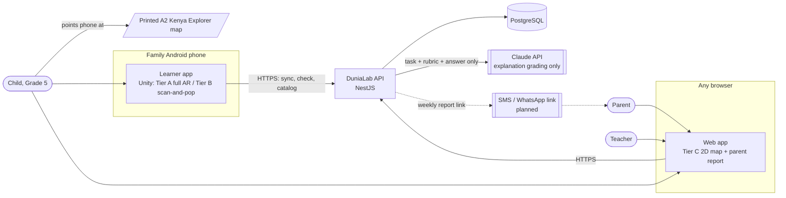
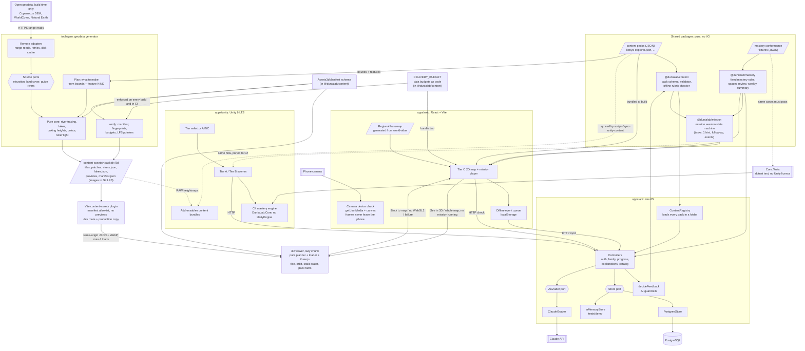

# DuniaLab Architecture

> **Rule:** every architectural change updates this folder **in the same PR**:
> the diagram(s) it affects and a line in the [change log](#architecture-change-log).
> An "architectural change" is any new or removed component, data store, external
> service, cross-component call, data flow, or extension point.
> See [`CLAUDE.md`](../../CLAUDE.md) and [ADR-0004](../adr/0004-content-packs-are-the-extension-point.md).

Diagrams are [Mermaid](https://mermaid.js.org): text in Markdown, rendered by GitHub
and VS Code, and reviewed in diffs like code.

| Doc | What it shows |
|---|---|
| This page | System context, components and "what touches what", extension points |
| [flows.md](flows.md) | Sequence diagrams for the key runtime flows |
| [data-model.md](data-model.md) | Database tables and what we deliberately do **not** store |

---

## 1. System context

Who and what DuniaLab talks to.

**Boundaries that matter**

- **No camera image leaves the phone.** Map recognition runs on the device. The web camera
  device check (Tier B precursor) holds its stream locally and draws to a local canvas; it has no
  API client, and an E2E test asserts no request carries a frame.
- **Claude never sees who the child is.** It receives the task, rubric, approved hints, exemplar, locale and the answer text, with phone numbers, emails and links **redacted first**, and only for parents who consented to the current policy. Nothing else.
- **Open geodata is used at build time only.** The generator (`tools/geo`) downloads elevation and land-cover data on a developer machine; learners' devices only ever fetch our own generated files from our own origin (ADR-0009).
- **A mission never waits on the network.** The only online step (the AI check) has an offline fallback.

---

## 2. Components: what touches what

### Dependency rules

1. `packages/*` are **pure**: no network, no database, no framework. Every app can use them.
2. Apps depend on packages, **never on each other** (they talk over HTTP).
3. The API depends on **ports** (`Store`, `AiGrader`), not on Postgres or Claude directly. Adapters are chosen once, in `main.ts` / `app.factory.ts`.
4. Logic that exists in two languages (mastery rules in TypeScript and C#) is specified by **shared JSON fixtures**. Change the fixture first.

---

## 3. Extension points (how DuniaLab grows without touching the POC)

Built in from day one, so new grades, subjects and countries are **content drops**, not rewrites.

| To add... | You change | You do NOT change |
|---|---|---|
| A new grade / subject / country (e.g. Grade 6 East Africa, Tanzania) | Add a pack JSON to the packs folder (+ its print target and 3D assets for Unity) | API, web, mastery engine |
| A mission or task to an existing pack | The pack JSON; run `npm run validate:content` | Any code |
| A new task type (e.g. drag-and-drop) | `packages/content` schema + `packages/mission` + each client renderer | API sync/mastery (they only see events) |
| A new region's basemap (web) | `npm run basemap -w @dunialab/web` after adding the pack | Map component |
| A new language | Add the locale to `LocalizedText` and translate packs | Mastery, sync |
| 3D terrain, rivers and lakes for a new pack (ADR-0009) | `npm run geo:build`; review `previews/`; commit `content-assets/<packId>/3d` | Generator code, 3D viewer |
| HD close-ups for another kind of feature | `patchKmByKind` in `tools/geo/src/plan.ts` (a kind and a size in km) | Any id-specific code (there is none) |
| A different elevation or land-cover provider | A new adapter for the source ports in `tools/geo/src/plan.ts` | The generator core, the manifest |
| A different AI provider | A new `AiGrader` adapter | Controllers, guardrails |
| A different database | A new `Store` adapter | Controllers |
| A new mastery rule | A fixture case, then TypeScript + C# | Content packs |

Guarded by the feature test `tests/features/api/new-grade-is-a-content-drop.feature.test.ts`.

---

## Architecture change log

Newest first. One line per change; link the PR/ADR.

| Date | Change | Diagrams updated | Ref |
|---|---|---|---|
| 2026-11-17 | 3D Explorer, Phase 2: lazy web viewer, pure scene planner, bounded same-origin loader and Vite manifest allowlist (dev serving / production copy, previews excluded). Terrain rise, orbit, labels, lake surfaces and static rivers; localized facts and source notices; 2D fallback and mission isolation. WebGL E2E and first-open budget enforced | Components, Flow 6 | [ADR-0008](../adr/0008-3d-rendering-stack.md), [ADR-0010](../adr/0010-web-terrain-rendering.md) |
| 2026-11-16 | 3D Explorer, Phase 0 (decisions and spikes): `tools/geo` workspace with a one-window Copernicus DEM spike; data budgets as code (`DELIVERY_BUDGET` in `@dunialab/content`) with a production-bundle test; E2E WebGL2 harness (SwiftShader, screenshot read-back). Planned, not built: generator, `content-assets/`, 3D viewer. Open geodata is a **build-time** source only; nothing new is contacted at runtime | Components, Extension points | [ADR-0008](../adr/0008-3d-rendering-stack.md), [ADR-0009](../adr/0009-geodata-sources-and-3d-assets.md) (both Proposed) |
| 2026-11-08 | Web camera device check (Tier B scan-and-pop precursor): `getUserMedia` + local canvas capture, no network path; HTTPS dev server (`npm run dev:phone`) so a real phone has a secure context | Context, Components | `apps/web/src/components/CameraCheck.tsx` |
| 2026-11-07 | PR #1 review: AI egress gate (current-policy consent required; phone/email/URL redaction before the provider); web queue ownership per learner (guest events adopted once, per-session guest id rotated on sign-out); dev ports bound to loopback; CI least-privilege token | Context, Flows | [ADR-0005](../adr/0005-ai-guardrails.md) amendment |
| 2026-11-07 | CI pipeline: build + features + unit, C# core via dotnet, E2E (Postgres service + Chromium), Docker build | n/a (pipeline) | `.github/workflows/ci.yml` |
| 2026-11-07 | Web Tier C: bundled packs, offline event queue, regional basemap (world-atlas cut to pack bounds) | Components | `apps/web` |
| 2026-11-07 | `@dunialab/mission`: tier-agnostic mission session shared by web and (ported) Unity | Components, Flows | ADR-0004 |
| 2026-11-07 | Unity `DuniaLab.Core` (plain C#) + `Core.Tests` (dotnet) running the shared mastery fixtures; tier selector | Components | ADR-0002, ADR-0003 |
| 2026-11-07 | API container image (`docker/api.Dockerfile`) and compose `app` profile for E2E | Context | this PR |
| 2026-11-07 | Content registry + catalog: packs are the extension point; progress scoped by `packId` | Components, Extension points | [ADR-0004](../adr/0004-content-packs-are-the-extension-point.md) |
| 2026-11-07 | AI grading behind `AiGrader` port with guardrails + offline fallback | Context, Components, Flows | [ADR-0005](../adr/0005-ai-guardrails.md) |
| 2026-11-07 | Event-sourced mastery with shared TS/C# conformance fixtures | Components, Flows, Data model | [ADR-0003](../adr/0003-event-sourced-mastery.md) |
| 2026-11-07 | Monorepo created; 2019 Oman Maps archived to `legacy/` | All | [ADR-0001](../adr/0001-rebuild-as-monorepo.md) |
