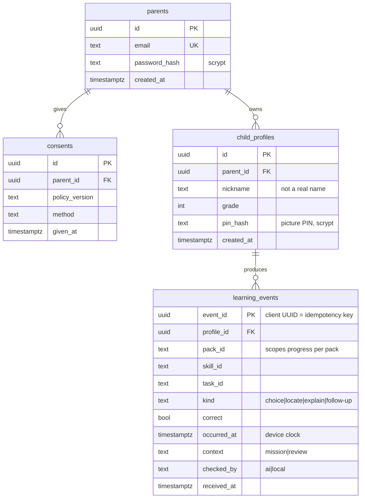

# Data model

Source of truth: [`apps/api/src/db/schema.ts`](../../apps/api/src/db/schema.ts). Migrations: `apps/api/drizzle/`.
Update this diagram in the same PR as any schema change.

## Deliberately NOT stored (data minimisation)

| Not stored | Why |
|---|---|
| Child's real name, date of birth, photo | Not needed for learning; ODPC guidance asks for minimal data |
| Location, device identifiers | Not needed |
| Camera frames | Map recognition happens on the device |
| Voice recordings | Narration is pre-recorded; children never record |
| Mastery status | **Derived** from `learning_events` every time (event sourcing), so it can never drift |
| Explanation text | Not stored in the MVP. The AI-vs-teacher agreement study needs a separate, consented, time-limited dataset (see DPIA) |

Adding any personal-data column needs a DPIA update and an ADR.

## Retention and deletion (to implement before the pilot)

- Parent deletes the account → `ON DELETE CASCADE` removes consents, profiles and events.
- Fixed retention schedule for inactive accounts: open question for the Kenyan data protection lawyer.
