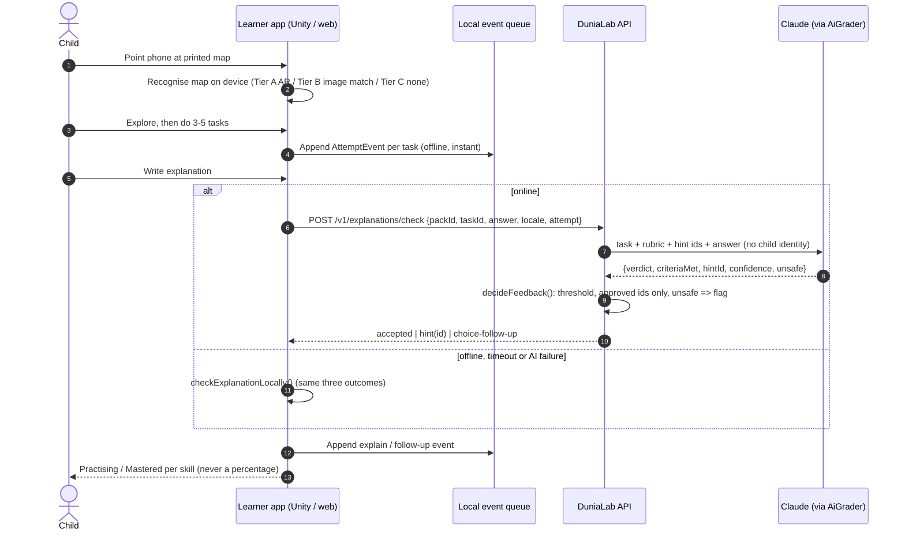
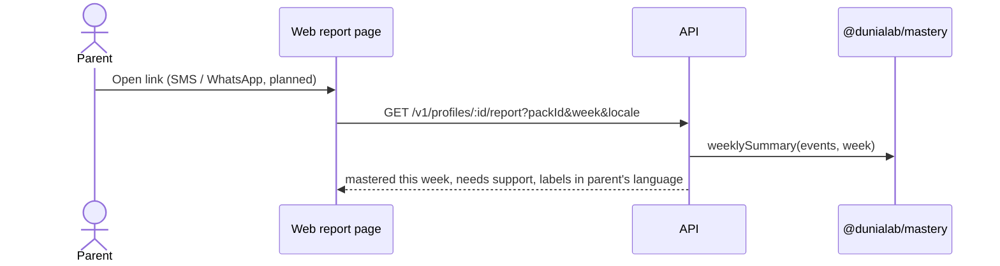

# Key runtime flows

Update the matching diagram whenever one of these flows changes. See the rule in [README.md](README.md).

## 1. One mission session (about 15 minutes)

Scan → explore → mission → explain → feedback → (later) review → report.



## 2. Offline-first sync

```mermaid
sequenceDiagram
  autonumber
  participant Q as Local event queue (phone)
  participant API as API /v1/sync
  participant DB as Postgres learning_events
  participant M as @dunialab/mastery

  Note over Q: Events carry a client UUID (eventId)
  Q->>API: {profileId, packId, events[<=500]}
  API->>API: parent owns profile? (else 404)<br/>skills exist in pack? (else 400, whole batch)
  API->>DB: INSERT ... ON CONFLICT (event_id) DO NOTHING
  DB-->>API: rows inserted
  API->>DB: SELECT all events for (profile, pack)
  API->>M: computeSkillStates(events, rules)
  API-->>Q: {accepted, duplicates, skills[]}
  Q->>Q: Drop acknowledged events; adopt server skill states
```

Retries are safe: re-sent events become `duplicates`, never double counted.

## 3. Weekly parent report



## 4. Adding a new grade (content drop)

```mermaid
flowchart LR
  A[Teacher-designer writes pack JSON] --> B[npm run validate:content]
  B -->|fails| A
  B -->|ok| C[Teacher sign-off: review.status = approved]
  C --> D[Drop into packs folder]
  D --> E[API ContentRegistry loads it at start]
  E --> F[/v1/catalog lists it]
  D --> G[sync-unity-content -> Addressables bundle]
```
