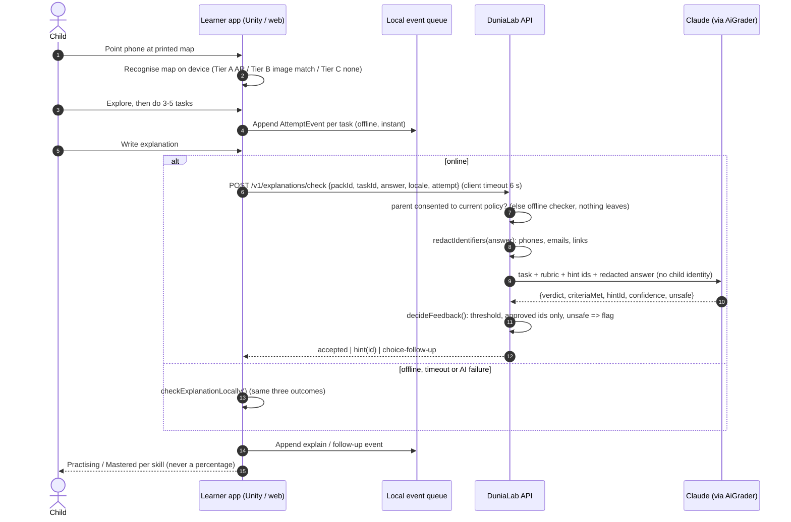
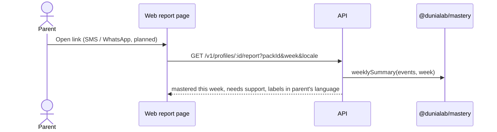

# Key runtime flows

Update the matching diagram whenever one of these flows changes. See the rule in [README.md](README.md).

## 1. One mission session (about 15 minutes)

Scan → explore → mission → explain → feedback → (later) review → report.



## 2. Offline-first sync

```mermaid
sequenceDiagram
  autonumber
  participant Q as Local event queue (phone)
  participant API as API /v1/sync
  participant DB as Postgres learning_events
  participant M as @dunialab/mastery

  Note over Q: Events carry a client UUID (eventId)
  Q->>API: {profileId, packId, events[<=500]}
  API->>API: parent owns profile? (else 404)<br/>skills exist in pack? (else 400, whole batch)
  API->>DB: INSERT ... ON CONFLICT (event_id) DO NOTHING
  DB-->>API: rows inserted
  API->>DB: SELECT all events for (profile, pack)
  API->>M: computeSkillStates(events, rules)
  API-->>Q: {accepted, duplicates, skills[]}
  Q->>Q: Drop acknowledged events; adopt server skill states
```

Retries are safe: re-sent events become `duplicates`, never double counted.

**Ownership on a shared phone.** The device queue is per learner. An event's `profileId` never changes once it
belongs to a child; sync sends only the selected child's events. Events played before a parent links the device
carry a per-session **guest id** and are adopted once by the first child linked. Sign-out issues a new guest id, so
the next family can never adopt this family's guest play.

## 3. Weekly parent report



## 4. Adding a new grade (content drop)

For 3D terrain, rivers and lakes of the new pack, also run flow 5.

```mermaid
flowchart LR
  A[Teacher-designer writes pack JSON] --> B[npm run validate:content]
  B -->|fails| A
  B -->|ok| C[Teacher sign-off: review.status = approved]
  C --> D[Drop into packs folder]
  D --> E[API ContentRegistry loads it at start]
  E --> F[/v1/catalog lists it]
  D --> G[sync-unity-content -> Addressables bundle]
```

## 5. Generating a pack's 3D assets (build time, on a developer machine)

`npm run geo:build` (ADR-0009). Learners' devices are not involved: they later fetch only the
committed files, from our own origin.

```mermaid
sequenceDiagram
  autonumber
  actor Dev as Developer
  participant Gen as tools/geo generator
  participant Cache as .cache/geo (gitignored)
  participant Open as Open geodata (Copernicus DEM, WorldCover, Natural Earth)
  participant Out as content-assets/<packId>/3d
  actor Teacher

  Dev->>Gen: npm run geo:build
  Gen->>Gen: read every pack: map bounds + features (kind, anchor, rough river line)
  Gen->>Open: range requests for the levels and windows needed (retries on dropped connections)
  Open-->>Cache: raw rasters, cached; a second run needs no network
  Gen->>Gen: trace each river downhill to the sea or a lake, inside a corridor around the surveyed line
  Gen->>Gen: find each lake's flat surface and outline
  Gen->>Gen: bake heights, surface colour and relief light: overview tiles, regional tiles, HD patches (by feature kind)
  Gen->>Out: tiles, patches, rivers.json, lakes.json, previews, manifest.json (SHA-256 + size per file, sources, licences, review flags)
  Gen->>Gen: verify files against the manifest and the data budgets (exit 1 on any problem)
  Dev->>Teacher: previews/*.jpg for review
  Teacher-->>Dev: approve, or correct the pack (anchor, rough line) and regenerate
  Dev->>Out: commit (images through Git LFS)
  Note over Out: CI verifies sizes, fingerprints and budgets from the LFS pointers on every run,<br/>and the real pixels only when assets, generator or packs change
```
