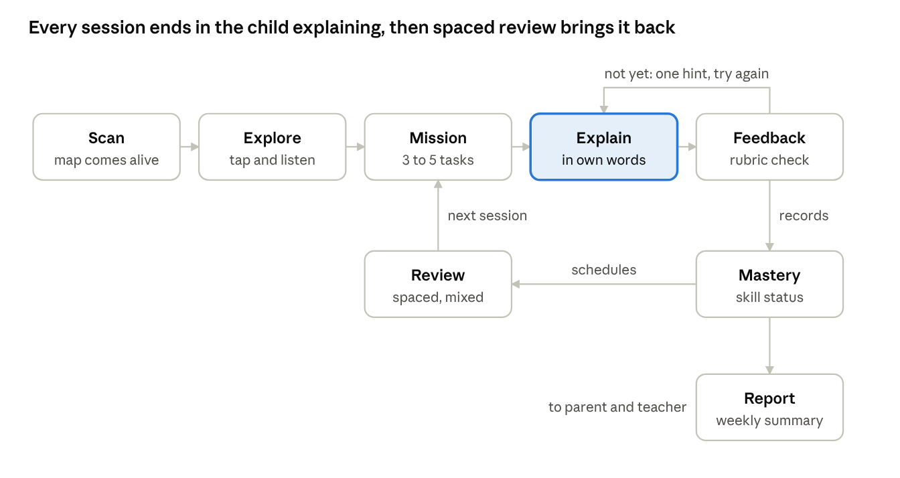
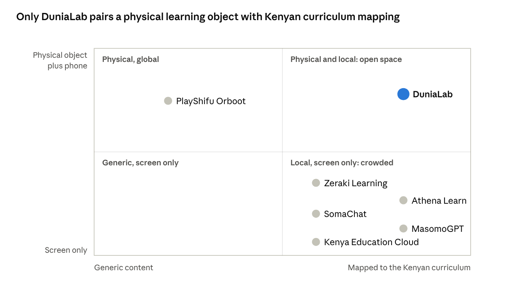
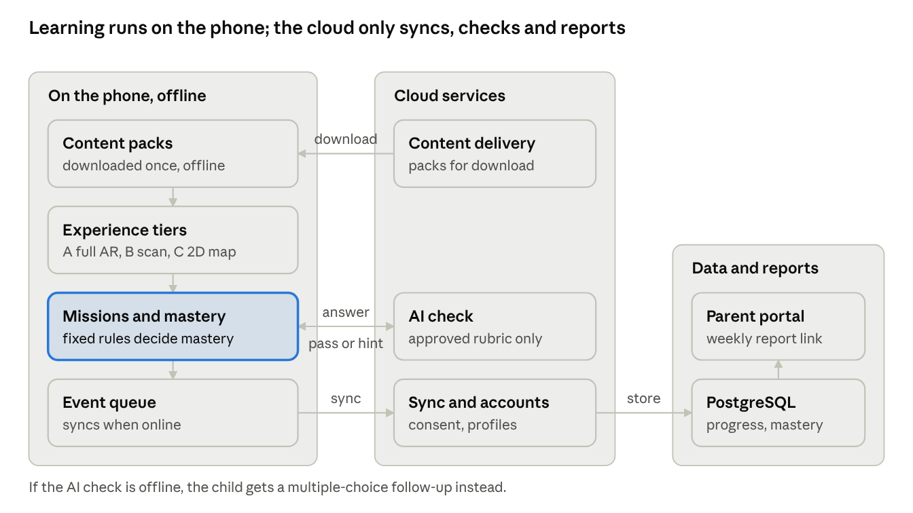
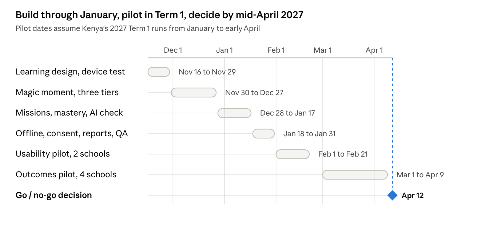

# DuniaLab — Product Definition & Validation

Nov 7, 2026 · last updated 19 November 2026

> **This Markdown file is the source of truth for the product definition.** Update it here, in the same change as the
> work it describes. It was converted from the original Word file on 19 November 2026; that file
> (`DuniaLab — Product Definition & Validation.docx`, same folder) is kept for reference only and is no longer updated.

## Executive summary

**DuniaLab is worth building, but only as a narrower product than the original proposal describes.** We build one excellent Grade 5 Social Studies experience: a printed map of Kenya that comes alive on a phone. Each child gets missions, explains what they found, and receives a mastery report that a parent or teacher can read. AR is the hook. The learning loop is the product.

**What DuniaLab is, in one line:** printed, curriculum-mapped learning maps and kits that come alive on any Android phone, each mission ending with the child explaining what they learned, and a mastery report a parent or teacher can trust.

**The bet:** Kenyan children learn abstract curriculum content (maps, landforms, climate) better when they explore it physically and then explain it. Schools and parents will pay for proof that this happened, not for screen time.

**Checking the proposal changed four things:**

1. **The grade is wrong.** The map of Kenya and its physical features is Grade 5 Social Studies. Grade 4 studies the learner's own county, which would mean 47 different maps. The MVP moves to Grade 5.
2. **The classroom channel goes to the wrong grade.** The government smartboards (10,382 schools in phase 1) go to junior schools (Grades 7–9), not to Grades 4–6 classrooms. Classroom mode on those boards becomes a Phase 2 product for Grade 7.
3. **Many children's phones cannot run full AR.** ARCore only runs on certified phones, and many budget Android phones are not certified. DuniaLab must work on any phone with a camera, with full AR as a bonus where the phone supports it.
4. **Two competitor claims could not be verified.** The question counts quoted for Mwalimu.ai and SOMA could not be confirmed from public sources and are left out.

**Three things must be proven before scaling:**

1. Children come back in week 3 without being pushed.
2. Children using DuniaLab score better than a comparison class on a test taken weeks later.
3. A private school or a parent actually pays, at a price that covers the cost of making the content.

**Recommended first customer:** private primary schools, with parents reached through the school. Selling directly to parents and selling to government come later, once there is evidence.

## Origin: what Oman Maps proved in 2019

Oman Maps proved the moment of delight and won institutional attention. It did not prove learning, return use or payment. Those are the three things DuniaLab has to add.

**What was built.** A Unity 2018.3 Android app using Vuforia image tracking over a printed Arabic map of Oman. Pointing a phone at the paper brought up 3D cards for each governorate (capital, population, description), tourist sites with photos (Bahla Fort, the Bat tombs), and wilayat. It placed 2nd at Oman's national inter-university tech expo in Muscat and led to a meeting at the Ministry of Education.

| What it proved | What it did not prove |
|---|---|
| Paper plus phone creates a strong first moment for children and judges | That children learned more than from the printed map alone |
| A cheap printed target is enough; no special hardware needed | That children return after the novelty fades |
| Government officials see value in it (the Ministry meeting) | That anyone pays, or who that would be |
| One developer can build the AR layer | That content scales beyond one hand-built map |

**What carries forward:** the interaction pattern (scan, reveal, tap to explore), the mode switching (information, places, regions) and the founder's credibility story. **What does not:** the code. The archived repository contains only Vuforia sample targets and an empty scene, and the 2018 Unity, ARKit-plugin and Vuforia setup is obsolete. DuniaLab is a rebuild, not a revival.

## Problem and customer

Kenyan upper-primary learners are being assessed on applying and explaining concepts, but many lack the foundations, and abstract topics like maps and landforms are taught mostly from flat textbooks. The person who pays (a parent or school) is not the person who uses the product (the child). That split shapes everything below.

**The learning gap is real and measured.** The 2025 FLANA assessment found that by Grade 4 only 49.6% of learners can read a Grade 3 English story, 33.8% can solve a Grade 3 numeracy problem, and 29.8% can do both ([Standard](https://www.standardmedia.co.ke/education/article/2001539595/alarm-as-millions-of-pupils-lack-basic-reading-and-numeracy-skills)). Social Studies questions that ask a child to read a map and explain a pattern sit on top of those weak foundations.

**The assessment format rewards what DuniaLab trains.** KNEC's 2026 Grade 5 school-based assessment in Social Studies gives learners a map of Kenya and asks them to answer questions about it, such as which countries border Kenya ([KNEC scoring guide](https://educationnewshub.co.ke/wp-content/uploads/2026/10/Grade_5_Social_Studies_Scoring_Guide.pdf)). Reading a map and explaining it is exactly the skill set.

### Who has the job, who pays, who decides

| Actor | Role | Job to be done | What they need to see |
|---|---|---|---|
| Learner, Grade 5 (about 10–11 years) | User | "Help me understand this so I can answer in class and not feel lost." | Fun in the first minute; feeling smart, not tested |
| Parent | Payer (consumer) | "Show me my child is actually learning, not just playing on my phone." | A weekly mastery report in plain language; healthy screen time |
| Private school owner or head teacher | Payer (business) | "Differentiate my school and lift assessment results that parents can see." | Evidence of results, a low-effort setup, a price per learner per term |
| Class teacher | User and gatekeeper | "Save me preparation time and show me who did not get it." | Ready-made missions mapped to the scheme of work; a class report |
| Publisher | Channel | "Make my textbook stand out against competitors." | A co-branded digital layer with no upfront cost to them |
| Government (ICT Authority, Kenya Institute of Curriculum Development) | Later buyer and regulator | "Get approved, curriculum-aligned content onto the digital devices we have deployed." | Approval from the Kenya Institute of Curriculum Development; measured outcomes |

**Why now.** Four things changed since 2019:

- **The curriculum is now competency-based.** Assessment asks learners to apply and explain, not recite.
- **AI is cheap enough to check explanations.** Giving feedback on a child's short written explanation now costs a fraction of a shilling per check (an assumption, to be confirmed by measurement).
- **Government is putting digital devices into schools.** That creates a future route into classrooms.
- **Data protection guidance for children is now clear.** The Office of the Data Protection Commissioner (ODPC) adopted guidance on processing children's data on 6 November 2025 ([Digital Policy Alert](https://digitalpolicyalert.org/change/16727-guidance-note-on-the-processing-of-childrens-data)), so the compliance rules are known.

## Product definition

DuniaLab turns a printed curriculum resource into a guided mission. The child explores it, practises, explains it in their own words, and then the system checks and schedules review. Each session runs the same loop: scan, explore, mission, explain, feedback, review, report.

*DuniaLab learning loop · one session plus review*

The explanation step is what sets DuniaLab apart from AR toys. The review loop is what makes the learning last.

### What it is and what it is not

| DuniaLab is | DuniaLab is not |
|---|---|
| A physical-plus-digital learning kit mapped to specific curriculum outcomes from the Kenya Institute of Curriculum Development | A homework chatbot or an open AI chat window |
| A small set of deep missions per topic, each ending in an explanation | A library of thousands of questions or videos |
| Usable on any Android phone with a camera; full AR is a bonus | An app that only works on phones certified for ARCore |
| Mostly offline once a content pack is downloaded | A streaming service |
| Built on assessments with fixed answer keys; AI writes hints and checks explanations | A system where a language model decides whether a child has mastered a topic |

### Flagship: Kenya Explorer (Grade 5 Social Studies, Strand 1)

The flagship covers Strand 1.0, Natural and Built Environments, of the Grade 5 curriculum design ([curriculum design summary](https://mwalimufocus.co.ke/curriculum-designs/7022/grade-5-rationalized-social-studies-curriculum-design)). That strand has four sub-strands totalling 17 suggested lessons. The MVP covers the two that use the map most.

| Sub-strand (lessons) | In MVP | Example mission | What the child must explain |
|---|---|---|---|
| Elements of a map (4) | Yes | "The map is broken." Restore the title, key, compass and scale to a damaged map | Why a map without a key or scale cannot be used |
| Main physical features in Kenya (5) | Yes | "Expedition." Find Mount Kenya, the Rift Valley and Lake Victoria, which rise in 3D | Why the climate near a mountain differs from the climate at the coast |
| Location, position and size of Kenya (4) | V2 | "Border patrol." Name the neighbouring countries and find Kenya's position | How Kenya's position affects trade and climate |
| Weather and climate (4) | V2 | "Weather station." Use the offline sunlight-and-water challenge at home | What they observed and why it happened |

### The child's experience in one session (about 15 minutes)

1. **Scan:** the child points the phone at the printed map. The terrain rises in 3D, or opens as a 3D view on phones without full AR (see Technology).
2. **Explore:** free tapping for about 2 minutes. Landforms reveal short narrated facts in English or Kiswahili.
3. **Mission:** 3–5 tasks. The questions have fixed answer keys and are reviewed by teachers.
4. **Explain:** the child types or chooses words to build a one- or two-sentence explanation. The AI compares it to a scoring rubric and either accepts it or gives one hint.
5. **Feedback:** the child sees the mastery status for each skill (Practising or Mastered), not a percentage.
6. **Review:** short spaced-review questions come back over the following days and weeks, mixing topics so the child does not just repeat the last thing studied.
7. **Report:** the parent gets a weekly summary of what was mastered, what needs support and one activity to do together.

### Feature priority

| Feature | MVP | V2 | Later |
|---|---|---|---|
| Printed Kenya Explorer map (A2) + 2 sub-strands, 6 missions | ✓ |  |  |
| Three experience tiers: full AR, 3D view, flat 2D map | ✓ |  |  |
| English and Kiswahili narration, recorded in advance | ✓ |  |  |
| Mastery engine with spaced review | ✓ |  |  |
| AI hints and explanation checking, limited to approved content | ✓ |  |  |
| Parent weekly report (in app, plus SMS or WhatsApp link) | ✓ |  |  |
| Offline missions to do at home ("Explorer challenges") | ✓ (2) | more |  |
| Teacher class report | basic | full |  |
| Classroom presentation mode (laptop or projector) |  | ✓ |  |
| Remaining Grade 5 sub-strands, then Grade 6 East Africa |  | ✓ |  |
| Grade 7 Africa Explorer for junior-school smartboards |  |  | ✓ |
| Science and agriculture kits; Tanzania and Uganda curriculum packs |  |  | ✓ |

### The five engines

The proposal's five engines stay. Their scope for the MVP is tightened:

1. **Curriculum engine.** A table linking each sub-strand and learning outcome to the missions, questions and rubrics that cover it. A teacher signs off every row.
2. **Experience engine.** Unity scenes per map, delivered in three tiers, packaged as downloadable content packs.
3. **AI teaching engine.** Hint wording and explanation checking only, grounded in the approved rubric. No free conversation.
4. **Mastery engine.** Fixed rules on each skill (for example, Mastered = correct on two separate days, including one explanation). It also schedules spaced review.
5. **Family and classroom engine.** Parent reports, consent management, and teacher class views.

## Validation of the proposal's claims

Of 10 claims checked, 4 hold, 3 hold only with corrections, 2 are wrong in ways that change the MVP, and 1 (two competitor figures) could not be verified. The wrong ones are about grade fit and device fit, the two things the MVP depends on most.

| Claim in the proposal | Verdict | Evidence | What it changes |
|---|---|---|---|
| Grade 4 Social Studies covers the interactive map of Kenya | **Wrong** | Grade 4 Strand 1 covers compass direction and the learner's own county: its location, physical features and seasons ([Grade 4 design](https://mwalimufocus.co.ke/curriculum-designs/7013/grade-4-rationalized-social-studies-curriculum-design)). Kenya's location, size and main physical features are Grade 5 ([Grade 5 design](https://mwalimufocus.co.ke/curriculum-designs/7022/grade-5-rationalized-social-studies-curriculum-design)) | MVP moves to Grade 5. A Grade 4 product would need 47 county maps |
| The smartboard rollout is a route into our target classrooms | **Wrong for this grade** | 10,382 public junior schools get one 65-inch smartboard and one teacher laptop each in phase 1, with more than 21,000 targeted overall ([CIO Africa](https://cioafrica.co/kenya-begins-distribution-of-digital-learning-devices-to-over-10000-schools/), [Education News](https://educationnews.co.ke/?p=521321)). Junior school is Grades 7–9 | Classroom mode on smartboards needs a Grade 7 product (Africa physical features). Moved to Phase 2 |
| More than 64,000 teachers trained | **Close** | 62,364 teachers trained in phase 1, across all 47 counties ([TechAfrica News](https://techafricanews.com/2026/09/14/kenyas-digital-smartboards-programme-reaches-10384-public-junior-schools/)) | Use 62,364 |
| 53.7% of Kenyans aged 3+ own a mobile phone; 64.6% urban vs 48.6% rural | **Holds** | Communications Authority and Kenya National Bureau of Statistics report on the 2023/24 Kenya Housing Survey ([AllAfrica](https://allafrica.com/stories/202508120006.html)). Also 93.8% of households own a phone ([Nairobi Leo](https://nairobileo.co.ke/business/article/22378/men-outpace-women-in-mobile-ownership-and-internet-usage---knbs-report)) and 11.3% of people use a phone they do not own | Design for the **parent's shared phone**, not the child's own: household reach is high, child ownership is low |
| The Office of the Data Protection Commissioner published 2025 guidance on children's data | **Holds** | Adopted 6 November 2025 under the Data Protection Act 2019 ([Digital Policy Alert](https://digitalpolicyalert.org/change/16727-guidance-note-on-the-processing-of-childrens-data), [the guidance itself](https://www.odpc.go.ke/wp-content/uploads/2025/11/ODPC-%E2%80%93-Guidance-Note-for-Processing-Childrens-Data.pdf)). It asks for proportionate age checks that collect as little data as possible, and includes a section on registering with the Commissioner | Compliance is a design input from day one |
| Kenya Education Cloud already provides free curriculum content | **Holds** | The Kenya Institute of Curriculum Development distributes approved digital content, including interactive content, through it ([ICT Authority tender clarification](https://cms.icta.go.ke//sites/default/files/2026-06/Clarification%20no.%201%20KICD%20Grade%209%20.pdf)) | Do not build a content library. Build the experience |
| AI tutoring in Kenya is already crowded | **Holds** | Active products include SomaChat's SOMA AI on WhatsApp ([iHub](https://futureoflearning.ihub.co.ke/startup-directory/somachat-services/)), Somo-GPT in a closed beta at 500 high schools ([Meta](https://ai.meta.com/blog/upeo-labs-llama/)), MasomoGPT ([Caplight](https://www.caplight.com/company/masomogpt)), Athena Learn offline for junior school ([Athena](https://athena-ai-web.vercel.app/)) and Zeraki Learning ([App Store](https://apps.apple.com/cd/app/id6756706838)) | Confirms the decision not to lead with a tutor |
| Mwalimu.ai advertises more than 16,000 questions; SOMA more than 64,000 | **Not verified** | Neither figure was found on public pages in this review | Left out of the case. Check directly before quoting |
| The AR experience can run on Android via Unity, AR Foundation and ARCore | **Partly** | ARCore runs only on certified devices; the Samsung Galaxy A10e, for example, is not supported ([PTC community](https://www.ptcusercommunity.com/t5/Vuforia-Chalk/Samsung-A10-compatibility/m-p/665983)). Kenya's market is led by Samsung (about 30%) and the Transsion brands (TECNO, Infinix, itel) at the budget end ([Tech-ish](https://tech-ish.com/2025/07/18/smartphone-market-share-in-kenya-june-2025/)) | Three experience tiers. Test the 20 most common phones in week 1 |
| A publisher QR channel is a strong distribution route | **Plausible, but the money works differently** | Government buys core textbooks at a 1:1 ratio through approval by the Kenya Institute of Curriculum Development and tenders. It still owed publishers about KES 7 billion in 2026 ([Nation](https://nation.africa/kenya/news/education/revealed-publishers-who-ll-share-billions-for-grade-11-textbook-tender-5623588)). Revenue-share digital deals exist: MasomoGPT reports an 80/20 split with Queenex Publishers ([Liners](https://liners.com/masomogpt)) | Offer publishers a revenue share with no upfront fee; do not expect licence payments |

## Market sizing

The realistic Kenyan consumer revenue in years 2–3 is small, in the tens of millions of shillings. Selling to schools and publishers is not optional; it is how the numbers work. The theoretical market is large, but the reachable slice depends on how many households can pay.

**The base numbers.** Primary and junior school enrolment reached 11.9 million in 2025 ([Education News](https://educationnews.co.ke/?p=514109)). Each upper-primary year group is about 1.3 million learners: 1,297,310 registered for the Grade 6 KPSEA assessment in 2025 (same source). Kenya had 39,339 primary schools in 2025 ([Radio Generation](https://radiogeneration.co.ke/news/87034/pre-primary-enrolment-rises-to-31-million-as-more-girls-join-classrooms)).

| Layer | Definition | Learners | Price assumption | Annual value |
|---|---|---|---|---|
| Theoretical ceiling (TAM) | All Grade 4–6 learners in Kenya, all subjects DuniaLab could eventually cover | ~3.9 million | KES 2,400 per year (KES 200 a month) | ~KES 9.4 billion |
| Serviceable market (SAM) | Grade 4–6 learners in households that could pay and have a suitable phone (assumed 20–30%), or in private schools | ~0.8–1.2 million | KES 2,400 per year | ~KES 1.9–2.8 billion |
| Obtainable in years 2–3 (SOM) | 1–2% of the serviceable market, mostly through schools | ~8,000–24,000 | KES 1,500 per year effective (after drop-off and school pricing) | ~KES 12–36 million (about USD 90,000–280,000) |

**How to read this.** Only the first column of numbers is sourced. The 20–30% serviceable share and the 1–2% capture rate are assumptions, and the pilot must replace them with real data. Even the obtainable range supports a small, lean team, not a venture-scale company. The paths to venture scale are:

1. More subjects and grades per learner, which raises revenue per learner.
2. Publisher bundles, which reach far more children at low cost per child.
3. Government purchases of approved interactive content for junior-school smartboards (Phase 2).
4. Country curriculum packs for Tanzania and Uganda.

**Open question:** the share of Grade 4–6 learners in private schools is not known from this review. It is the single most useful number for the business-to-school plan. Source it from the Kenya National Bureau of Statistics Economic Survey or the Ministry of Education's school statistics.

## Competitive landscape and positioning

Nobody in Kenya combines a physical learning object, missions mapped to the Kenyan curriculum, and verified mastery. That gap is real, but it is a gap in combination, not in technology. A funded competitor could copy the AR in a quarter. Defensibility has to come from content, approval and distribution.

*Positioning map · players named in this review; positions are qualitative*

The Kenyan market is crowded with screen-only products. The only physical product, Orboot, is global and not mapped to the Kenyan curriculum.

| Player | What it is | Price signal | Overlap with DuniaLab |
|---|---|---|---|
| [Zeraki Learning](https://apps.apple.com/cd/app/id6756706838) | Video lessons, quizzes and progress tracking | USD 2.99 a month for the CBC plan; earlier KES 20 a day through Safaricom | Parent reporting; screen-only |
| [SomaChat (SOMA AI)](https://futureoflearning.ihub.co.ke/startup-directory/somachat-services/) | AI study help on WhatsApp | Business-to-consumer subscriptions and pay per use | AI help; no physical object, no missions |
| [Somo-GPT](https://ai.meta.com/blog/upeo-labs-llama/) | Generative AI learning assistant | Closed beta at 500 high schools | Different grades |
| [MasomoGPT](https://liners.com/masomogpt) | AI tutoring and a digital library; publisher revenue share | Freemium subscription | Shows the publisher model works |
| [Athena Learn](https://athena-ai-web.vercel.app/) | Offline AI tutor for Grades 7–9, installed by USB | Free for public schools, funded by grants | Offline design; junior school |
| [Kenya Education Cloud](https://lms.kec.ac.ke/course/view.php?id=1683) | Government platform for curriculum content | Free | Content, not experience; sets a free baseline |
| [PlayShifu Orboot](https://stemfinity.com/products/shifu-orboot-earth) | AR globe for ages 4–10, offline after setup | USD 49.99 one-off, no subscription | Closest experience match; not Kenyan-curriculum, needs a 3 GB-RAM Android phone |

**Where DuniaLab wins:**

- **Physical and local.** A printed Kenya map tied to the exact Grade 5 sub-strands. Orboot is physical but global; the Kenyan players are local but screen-only.
- **Explains, not just answers.** The mission ends in the child's own explanation, which matches the competency-based assessment.
- **Works on the family phone.** Three experience tiers instead of an ARCore-only app.
- **Built in by design for children's data protection.**

### Moat analysis

| Source of defensibility | Strength | Why |
|---|---|---|
| AR technology | Weak | Commodity tools; copyable in months |
| Mission and rubric library mapped to curriculum outcomes, signed off by teachers | Medium, compounding | Slow to build well; each module adds to it |
| Data on common misconceptions, from children's explanations | Medium, compounding | Improves hints and teacher reports; needs volume |
| Approval from the Kenya Institute of Curriculum Development for digital content | Strong once earned | ICT Authority tenders for interactive content require proof of this approval ([ICT Authority](https://cms.icta.go.ke//sites/default/files/2026-06/Clarification%20no.%201%20KICD%20Grade%209%20.pdf)) |
| Physical distribution (maps in schools, publisher bundles) | Strong if achieved | Printed objects sit in classrooms and homes and pull children back to the app |
| Brand trust with parents and schools | Medium | Earned through visible results and clean data handling |

## Business model and unit economics

Sell to private schools first, priced per learner per term, with the printed kit included. The family plan comes in through the school, and publishers are a revenue-share channel. Every price below is a hypothesis to test in the pilot, anchored to what Kenyan buyers already pay for similar products.

### Revenue streams

| Stream | Buyer | Price hypothesis | Anchor | Priority |
|---|---|---|---|---|
| School licence | Private primary school | KES 200 per learner per term (KES 600 a year), printed maps included | Zeraki's CBC plan is USD 2.99 a month for one learner; schools need a lower price per seat | 1 |
| Family plan | Parent, mostly reached through the school | KES 199–299 a month, or KES 600 a term | Zeraki's KES 20 a day; TeachBetter at KES 218 a month for teachers ([TeachBetter](https://teachbetter.ai/?p=2544)) | 2 |
| Kit sale | Parent or bookshop | KES 500–800 one-off for the map, stickers and one free mission pack | Orboot sells a physical kit at USD 49.99 in richer markets | 2 |
| Publisher edition | Publisher | Revenue share, no upfront fee | MasomoGPT's 80/20 split with Queenex | 3 |
| Government content | ICT Authority or KICD | Tender for approved interactive content, Grade 7 and up | ICT Authority's 2026 Grade 9 interactive content tender | 4 (Phase 2) |

### Unit economics (assumptions to measure)

- **Content cost per sub-strand module:** an estimated KES 300,000–600,000. That covers 3D assets, 3–4 missions, rubrics, bilingual narration and teacher review. The MVP's two modules cost about KES 0.6–1.2 million, mostly founder time. At KES 600 a year per seat, one module pays for itself at roughly 500–1,000 school seats.
- **AI and infrastructure cost per learner:** the target is under 10% of revenue per learner, about KES 60 a year. AI is used only for checking explanations and wording hints, around 20–30 short calls per active learner per month; everything else is scripted and offline. Measure the real cost in the pilot before setting final prices.
- **Printing:** an A2 colour map runs to a low hundreds of shillings per copy at volume (to be quoted locally). It is included in the school price and is the main variable cost.
- **Customer acquisition:** one school sale delivers 40–150 upper-primary seats. Paid ads aimed directly at parents are the most expensive route and are deferred.

### Year-2 scenarios (illustrative)

| Scenario | Paying family learners | School seats | Revenue (KES) | Comment |
|---|---|---|---|---|
| Bear | 1,500 | 3,000 (about 20 schools) | ~4.1 million | Does not cover a small team; stay part-time |
| Base | 5,000 | 15,000 (about 100 schools) | ~16.5 million | Covers a team of 3–4 in Nairobi |
| Bull | 15,000 | 50,000 (schools plus a publisher bundle) | ~52.5 million | Justifies raising money for more subjects and countries |

The scenarios assume KES 1,500 of effective annual revenue per family learner and KES 600 per school seat. A team of 3–4 is assumed to cost about KES 7–8 million a year. The base case breaks even; the bear case is a side project. The pilot exists to find out which one is real.

## Go-to-market

Enter through private primary schools in two or three urban counties, reach parents through those schools, and use the evidence to open publishers. Government comes only after the content is approved by the Kenya Institute of Curriculum Development. Each step starts only when the one before has produced proof.

1. **Pilot schools (months 1–3).** Two schools, one private and one public, with 40–60 Grade 5 learners. The purpose is evidence, not revenue.
2. **Private-school sales (months 4–9).** Nairobi, Kiambu and Mombasa first. Sell to the owner or head teacher with a 20-minute live demo in the school, the pilot results and a per-term price. Target: 20–30 paying schools.
3. **Family plan through the school (from month 4).** Each child takes the printed map home. The parent scans a QR code, consents and starts a free week. The school earns a referral credit.
4. **Publisher edition (months 9–15).** Approach two publishers of approved Grade 5 Social Studies books with a co-branded "Explorer" layer on a revenue share. Bring pilot data and the school count.
5. **Approval and government (months 12–24).** Submit the content for digital-content approval by the Kenya Institute of Curriculum Development. Build the Grade 7 Africa Explorer for junior-school smartboards and bid when the ICT Authority tenders interactive content.
6. **East Africa (after year 2).** Tanzania, then Uganda, each with its own curriculum mapping and partner. The same engine, new content packs.

**Founder advantage to use:** the Oman Maps story (a national award and a ministry meeting) opens doors with school owners and publishers. Lead with it in the first five minutes of every pitch, then show the Kenya product.

## Technology architecture

The architecture follows two rules: the child's experience works offline on a budget phone, and the AI never decides whether a child has mastered something. Unity drives the experience on the phone, a small cloud backend handles sync and reports, and a narrowly scoped AI service only checks explanations and writes hints.

*DuniaLab system architecture · MVP*

The only step that needs the network during a mission is the AI check, and it has an offline fallback.

### Three experience tiers (the key engineering decision)

| Tier | Runs on | What the child sees | How |
|---|---|---|---|
| A: Full AR | Phones certified for ARCore | 3D terrain anchored to the paper; walk around it | Unity with AR Foundation and ARCore image tracking |
| B: Scan and pop | Any Android phone with a camera, about 3 GB of RAM or more | The camera recognises the map, then opens a 3D model the child can rotate and tap | Image recognition without ARCore (for example OpenCV-based matching, or a licensed tracking SDK), then a 3D viewer |
| C: 2D map | Low-end phones, the classroom laptop, the web | An interactive flat map with the same missions | The same mission data, a 2D renderer |

All three tiers share one mission and mastery layer, so learning results are comparable across them. Week 1 of the build tests the 20 most common phones in pilot families to set the split between tiers.

### Stack

| Layer | Choice | Reason |
|---|---|---|
| Learner app | Unity (current long-term-support release), Android first | Reuses the founder's Unity experience; one codebase for all three tiers |
| Content delivery | Downloadable content packs (Unity Addressables), each about 30–50 MB | Download once on Wi-Fi, then play offline |
| Narration | Recorded voice in English and Kiswahili | Better Kiswahili quality than text-to-speech; works offline; no voice data from children collected |
| Backend | TypeScript (NestJS) with PostgreSQL | Accounts, consent, sync, reports |
| AI service | A hosted large language model behind our own API, given only the approved rubric and the mission | Short structured calls; output limited to one of a fixed set of feedback types |
| Parent and teacher portal | Web app plus SMS or WhatsApp report links | Parents read reports on the phone they already use |
| Classroom mode (V2) | Unity desktop build for the teacher laptop and projector | No AR needed on a big screen |

### Engineering decisions that protect the product

- **Fixed rules decide mastery.** The AI result is one input, with a confidence threshold. Below the threshold the child gets a multiple-choice follow-up instead.
- **Progress is recorded offline first.** Events queue on the device and sync when a connection appears; nothing in a mission waits on the network.
- **The app is built for a shared phone.** Several child profiles live on the parent's phone, each opened with a simple picture PIN, never with the child's personal details.
- **The app is kept small.** Target under 60 MB for the base app, plus one content pack.
- **No camera images leave the phone.** Map recognition runs on the device.

## Child safety, data protection and AI governance

DuniaLab collects as little as possible: a parent account, a nickname and grade for each child, and learning events. It has no open AI conversation, no messaging between users and no ads. Every safeguard below is designed in before the pilot, because a single privacy incident with children would end the company.

| Area | Control | Basis |
|---|---|---|
| Consent | The parent creates the account and gives verified consent before any child profile exists; schools sign a data-processing agreement | ODPC children's guidance; Data Protection Act 2019 |
| Age assurance | No ID checks on children. Age comes from the grade the parent or school states, a proportionate method | The guidance asks for proportionate checks that collect as little data as possible ([Biometric Update](https://www.biometricupdate.com/202505/kenya-releases-draft-guidance-on-biometrics-age-assurance)) |
| Minimum data | Nickname, grade, school (optional) and learning events only. No photos, no location, no stored voice recordings | Data minimisation |
| Registration | Register with the Office of the Data Protection Commissioner as a data controller before the pilot | The guidance has a section on registering with the Commissioner |
| Impact assessment | A written data protection impact assessment before any child uses the product | High-risk processing of children's data |
| Security | Encryption in transit and at rest, role-based access, audit logs, deletion when a parent asks and on a fixed retention schedule | Data Protection Act 2019 |
| AI scope | The model sees only the mission, the rubric and the child's short answer. Its output is limited to a fixed set of feedback types. No free conversation | Product rule |
| AI quality | Every rubric is tested against 50 or more real explanations written by children, marked by a teacher, before launch. Mismatches are reviewed every week during the pilot | Product rule |
| Commercial use | No advertising, no selling of data, no use of children's data to train a model without separate, explicit consent | Product rule; supports the concerns raised by civil society about commercial use of children's data ([Amnesty Kenya](https://www.amnestykenya.org/amnesty-international-kenya-and-5rights-foundation-comments-the-draft-guidance-note-for-processing-childrens-data/)) |
| Wellbeing | Sessions capped at about 20 minutes; reports show learning, not time spent; offline missions are encouraged | Product rule |

**Get legal advice on:** whether data transfers outside Kenya to the cloud and AI provider need extra safeguards, and the exact registration category. Use a Kenyan data protection lawyer before the pilot; this document is not legal advice.

## MVP scope, build plan and pilot

The MVP takes about 11 weeks to build, from mid-November 2026 to the end of January 2027, and is then piloted in Term 1 of 2027. The proposal's 6-week plan for a full build and pilot is not realistic for one engineer. The school calendar matters too: schools close from November to early January, so the pilot has to land in Term 1.

*MVP build and pilot plan · dates are planning assumptions*

The break between the two pilots gives one week to fix what the usability pilot uncovers before the outcomes pilot starts.

### MVP scope (fixed)

| Component | MVP |
|---|---|
| Grade and subject | Grade 5 Social Studies, Strand 1 |
| Sub-strands | Elements of a map; Main physical features in Kenya (9 of 17 suggested lessons) |
| Missions | 6, each ending with an explanation |
| Physical | One A2 printed Kenya Explorer map with a QR code |
| Experience | Tiers A, B and C |
| Language | English and Kiswahili narration |
| AI | Explanation checking and hint wording only |
| Mastery | Fixed rules for each skill, plus spaced review |
| Offline | Full mission play offline after one content-pack download |
| Parent | Consent, profiles on a shared phone, weekly report link |
| Teacher | Basic class mastery table |
| Out of scope | Classroom mode, other strands, payments inside the app (pilot billing is by invoice or a manual M-Pesa request) |

### Pilot design

**Usability pilot (3 weeks).** Two schools, 40–60 learners, as the proposal suggested. It answers: does it run on their phones, do children finish missions, do parents open reports?

**Outcomes pilot (6 weeks).** Four schools, about 8 Grade 5 classes. Half the classes in each school use DuniaLab and half continue as normal; which classes get it is decided at random. Every class takes a pre-test, a post-test and a delayed test 3 weeks later, using KNEC-style map items. With about 8 classes this gives a directional signal, not statistical proof. It is good enough for a go/no-go decision and for a school sales pitch, not for a research paper.

**Payment test inside the pilot.** In week 4, offer parents in the treatment group month 2 at KES 249, and record actual M-Pesa payments. Separately, ask each pilot school owner to sign a paid term licence for Term 2.

**Team for the MVP.** The founder (Unity, backend), a Grade 5 Social Studies teacher on contract (curriculum mapping, rubrics, review), a part-time 3D artist, and two voice artists for narration.

## Metrics, go/no-go gates and kill criteria

The pilot ends with one decision: scale, fix, or stop. Each metric has a target that means go and a floor that means stop, all written down before the pilot starts, so the result cannot be argued after the fact.

| Question | Metric | Go | Fix and retest | Stop |
|---|---|---|---|---|
| Does it run? | Share of pilot phones able to run Tier B or better | ≥ 80% | 60–79% | < 60% |
| Do children engage? | Learners completing 3 or more missions | ≥ 70% | 40–69% | < 40% |
| Does it survive the novelty? | Learners active again in week 3 without being pushed | ≥ 50% | 25–49% | < 25% |
| Do children learn? | Delayed-test gain compared with comparison classes | ≥ +10 percentage points | +3 to +9 points | No difference |
| Does the AI mark fairly? | Agreement between the AI and a teacher on explanations | ≥ 85% | 70–84% | < 70% |
| Do teachers want it? | Pilot teachers asking for the next module | ≥ 3 of 4 | 2 of 4 | ≤ 1 of 4 |
| Will parents pay? | Treatment-group parents who pay KES 249 for month 2 | ≥ 20% | 8–19% | < 8% |
| Will schools pay? | Pilot or nearby schools signing a paid Term 2 licence | ≥ 2 | 1 | 0 |

**Decision rules:**

- **Stop:** any "Stop" on learning, or on both payment metrics.
- **Fix and retest for one term:** two or more "Fix" results.
- **Scale to private-school sales:** "Go" on learning, engagement and at least one payment metric.

**North-star metric after launch:** skills mastered per active learner per month. It counts learning, not minutes, and it is what parents and schools are paying for.

## Risk register

The biggest risk is not technical. It is that children love the first session and then stop, while parents do not pay for a subject that is not examined in a high-stakes test. Both are tested directly in the pilot. The risks below are ranked by how badly they would hurt the business.

| # | Risk | Likelihood | Impact | Mitigation |
|---|---|---|---|---|
| 1 | The novelty fades: children stop after a week | High | High | Missions and spaced review rather than free exploration; offline challenges; week-3 return is a pilot gate |
| 2 | Parents will not pay for Social Studies | High | High | Lead with school licences; add Mathematics or Science once Social Studies works; prove gains with the test score |
| 3 | Budget phones cannot run the experience | Medium | High | Three tiers; test 20 devices in week 1; keep the app small |
| 4 | The AI marks children's explanations unfairly or wrongly | Medium | High | Fixed answer keys plus rubric; confidence threshold; teacher-marked test set; weekly review |
| 5 | A privacy or safety incident involving children | Low | Severe | Minimum data, no open chat, impact assessment, registration with the Commissioner, legal review |
| 6 | Content costs more than revenue | Medium | Medium | Reusable mission templates; one teacher-designer; price per seat that covers each module at 500–1,000 seats |
| 7 | A funded competitor adds AR to a tutor app | Medium | Medium | Build the moat in curriculum-mapped content, approval and printed distribution, not in the AR |
| 8 | Curriculum changes again | Medium | Medium | The curriculum engine maps missions to outcomes, so remapping is cheaper than rebuilding |
| 9 | Approval from the Kenya Institute of Curriculum Development is slow or denied | Medium | Medium (Phase 2) | Do not depend on it for the school and parent business; apply in year 2 |
| 10 | Founder bandwidth: a solo engineer alongside client work | High | High | Fixed MVP scope; a contract teacher-designer; build-week targets |

### Riskiest assumptions, in the order to test them

1. Children return in week 3.
2. The mission loop beats normal teaching on a delayed test.
3. A private school pays per seat.
4. Most pilot phones run Tier B.
5. The AI agrees with teachers on 85% or more of explanations.
6. Parents pay KES 249 a month.

## Next 30 days and open questions

The next 30 days are about removing uncertainty cheaply before writing much code: secure the teacher, the pilot schools and the device data.

- [ ] Contract a Grade 5 Social Studies teacher; map Strand 1 sub-strands 1 and 3 to missions and rubrics
- [ ] Secure 2 usability-pilot schools (1 private, 1 public) and 4 outcomes-pilot schools for Term 1 of 2027
- [ ] Survey 30 parents at those schools: phone model, RAM, data habits, and what they would pay for
- [ ] Test 20 common phone models for ARCore support and for Tier B performance
- [ ] Build the Tier B "scan and pop" prototype on the A2 Kenya map: the demo used in every pitch
- [ ] Draft the data protection impact assessment and book a consultation with a Kenyan data protection lawyer
- [ ] Get print quotes for an A2 map at 500 and 5,000 copies
- [ ] Run a trademark check on "DuniaLab" in Kenya, Tanzania and Uganda

**Open questions:**

- What share of Grade 4–6 learners attend private schools?
- What do private schools currently spend each term on digital or supplementary learning?
- Which publishers hold approved Grade 5 Social Studies titles, and who runs digital at each?
- What are the confirmed Term 1 dates for 2027 (the pilot timing assumes January to early April)?
- Are the Mwalimu.ai and SOMA question counts, and their prices, accurate today?

## Roadmap after the MVP (proposed, 19 November 2026)

**Status.** Proposed, not yet approved. Nothing in this section changes the fixed MVP scope. Each item starts only after the pilot gates in "Metrics, go/no-go gates and kill criteria" say go. Each is judged by one test: does it help a child learn, or a teacher teach? Being impressive is not enough.

**Where the build is.** The 3D Explorer adds a real 3D view to the web app (Tier C) ahead of the AR tiers. Its first three phases are built:

- **A generator** that makes each pack's terrain, rivers and lakes from open map data, with licences checked for commercial use.
- **The Kenya Explorer 3D files:** Mount Kenya, Kilimanjaro, Mount Elgon, the Rift Valley, Lake Victoria, Lake Turkana, and the River Tana traced from the highlands to the Indian Ocean.
- **The viewer** that opens them when a child taps a place.

The same generated terrain will feed the Unity tiers later. Details: `docs/briefs/3d-explorer.md`.

### What to take from global AR learning apps

Popular AR learning apps were reviewed (the Bentley University, BookWidgets and Cosmiq lists in Sources). They assume newer phones, steady internet and a curriculum other than Kenya's. None is built for the combination DuniaLab targets: the family's shared Android phone, offline use, Kiswahili and the Kenyan curriculum. That combination remains DuniaLab's gap (see Competitive landscape and positioning). The ideas worth taking:

| App | Idea worth taking | DuniaLab version |
|---|---|---|
| QuiverVision | A printed colouring sheet comes alive in 3D | Already DuniaLab's core idea. Next: the child colours their own printed map and the 3D appears in their colours |
| JigSpace | Step-by-step 3D explanations of how things work | Short "how it happened" stories: the Rift Valley pulling apart; a raindrop's journey from Mount Kenya to the sea |
| GeoGebra AR | Change a value and watch the result | Sliders: more rain raises the lake; cut a slice through the land and see its height profile |
| Sky Guide | The phone shows what is around you | From where the child stands, which way Mount Kenya is, and how far |
| Assemblr EDU, Delightex | Teachers build their own 3D lessons | A pack editor, so curriculum teams build new grades and countries without engineers |
| Merge Cube | A cheap physical object triggers the 3D | The printed A2 map is that object, and a product schools can buy |
| MondlyAR | Language practice in context | Every place narrated in English and Kiswahili; other Kenyan languages later |

### Reviewed: God's Eye View (19 November 2026)

[God's Eye View](https://github.com/bilawalsidhu/gods-eye-view) is a popular open-source 3D globe that brings live public data (flights, ships, satellites, weather, public cameras) into one place, with cinematic camera tours. It was reviewed as a possible engine or feature source for DuniaLab.

**Verdict: use it as a design reference, do not integrate it.** It shows how to tell geographic stories well; it does not fit how DuniaLab teaches or runs.

**What to borrow (ideas, not code):**

| God's Eye View capability | DuniaLab version | When |
|---|---|---|
| Camera tracking and cinematic tours | The Journey of the Tana: the camera follows the river and pauses at a few teacher-approved points, where the child predicts what happens next | Now: the first item in the recommended order |
| Director Mode: paths, outlines and annotations | A teacher marks a river or highlights a mountain range and saves a short guided lesson | Later: with the pack editor and classroom mode |
| Time controls and weather layers | Scrub between an approved wet-season and dry-season example, then explain the difference | V2: weather and climate, using packaged examples, never live feeds |
| Switchable layers | Show terrain, rivers or chosen features on their own, so children see how they relate | Only when a mission needs it, not as a panel of switches |
| Saved, shareable views | A teacher opens exactly the intended view and lesson step on a projector | Later: classroom mode; no learner identity in the link |

**Why not integrate it:**

- **It solves a different problem.** It is a live intelligence globe; its layers include public CCTV cameras and licence-plate reader locations, which have no place in a children's product. DuniaLab teaches a few deep, curriculum-mapped missions.
- **Its delivery model conflicts with ours.** It relies on outside services at runtime for imagery, terrain and live data; its photorealistic 3D needs a Cesium ion token (personal, non-commercial use) or a paid Google Maps key. DuniaLab must run offline after one download, on budget phones, within 3 MB for the first 3D view, and children's devices contact only our own servers. Running its server locally does not make its outside feeds offline.
- **It is not a drop-in upgrade.** It is built on CesiumJS and Vue; DuniaLab's viewer uses React and three.js. Using it would mean a second rendering stack or a large port. Cesium was already considered and rejected in ADR-0008.
- **Its code is open, but much of its data is not commercially usable.** The code is MIT-licensed. Its own data list marks several sources as non-commercial:
  - the Nepal flood scene's imagery and its derived river line (CC BY-NC 4.0);
  - the submarine cable map (CC BY-NC-SA);
  - OpenSky flight data;
  - Google News headlines;
  - most iNaturalist wildlife records.

  None of it can become a commercial DuniaLab lesson as it stands.

**What it adds to the learning loop.** Its tours make a good case for adding a **predict** step: explore → predict → explain → mastery. Pausing the river journey to ask "what happens next?" before revealing it turns the graphics into practice for the explanation the child writes at the end.

### Features only DuniaLab can offer

These combine the 3D map with what the product already has: the curriculum mapping, the explanation step, offline play on the shared phone, and the parent and teacher reports. Each one answers a pilot risk or gate.

| Feature | What it gives | Risk or gate it answers | Data protection |
|---|---|---|---|
| The Journey of the Tana | A narrated story mission: a raindrop falls on Mount Kenya and the child follows the real river to the Indian Ocean, in English or Kiswahili. It pauses at teacher-approved points for the child to predict what happens next, and ends with the child's explanation | Novelty fades (risk 1); learning gain | No new data |
| Slice the land | The child draws a line across the map and sees the land in cross-section: mountains, the Rift Valley, the coastal plain | Learning gain on main physical features | No new data |
| "How it happened" stories | Short 3D explanations of how landforms formed, each ending in the child's own explanation | Learning gain; the explanation step | No new data |
| One phone teaches the class | The teacher's phone shares the lesson pack with the children's phones over Wi-Fi Direct or Bluetooth, with no internet | Phones and data costs (risk 3); schools without connectivity | Lesson content only. Moving learner progress between phones needs an updated impact assessment first |
| Full teacher class view | Builds on the basic class mastery table that is already in the MVP: which skills the class has mastered, who needs help, and what to reteach, ready for the lesson | "Do teachers want it?" gate; school sales | Uses the existing learning events only; needs the school and class model decided first |
| Parent weekly message | Already in the MVP. In the parent's language, with one activity to do together | "Will parents pay?" gate | No change |
| Your county on the map | Lessons start from the child's own county, chosen by the parent or teacher from a list | Engagement; local relevance | No GPS: the county is chosen, not detected. Record it in the impact assessment |
| Colour your own map | The child colours the printed map and the 3D appears in their colours | Novelty fades (risk 1); the printed object pulls children back | The camera image is processed on the phone and never leaves it |
| Point your phone | Which way Mount Kenya is from where the child stands, and how far | Engagement | Needs the phone's location, which the data rules exclude today. Only if location stays on the phone, is never stored or sent, and after legal review |
| Weather and climate sliders | Rain, lake levels and the sea change before the child's eyes | Weather and climate sub-strand (V2) | No new data |
| Pack editor | Curriculum teams build and check new packs without engineers | Content cost (risk 6); Grade 6, Tanzania and Uganda | A staff tool; no learner data |
| AR on the printed map (Tiers A and B) | Already in the fixed MVP scope (not a later feature); reuses the generated 3D terrain. Whether it stays in the pilot MVP is an open decision, because Unity is not yet installed or scheduled | "Does it run?" gate | No camera image leaves the phone (already a rule) |

### Recommended order

1. **Finish the 3D Explorer.** Tell "Show river" as the Journey of the Tana, then add polish, offline storage after the first view, and a speed test on a real pilot phone.
   - *Done when:* it runs smoothly (30 frames a second or more) on a 2–3 GB phone and works in airplane mode after the first view.
   - *Why first:* it is the pitch demo, and it turns the "Main physical features" missions into a story.
2. **Slice the land, and the Rift Valley story.**
   - *Done when:* the teacher-designer has approved the wording and both are used in at least one mission.
   - *Why second:* they teach the sub-strand directly and end in the child's explanation.
3. **One phone teaches the class, and the full teacher class view.**
   - *Done when:* one phone shares a lesson with a class's phones without internet within one lesson period, and pilot teachers use the class view.
   - *Why third:* competitors cannot copy it quickly, and it is what makes schools buy.

This order sits alongside the fixed MVP scope, not in place of it. The MVP's Tiers A and B and its basic teacher class report still have to be delivered (see `docs/engineering/findings-register.md`, decisions D2 and D7).

**After the pilot says go:**

- Colour your own map.
- The pack editor.
- The weather and climate sliders.
- Point your phone (after legal review).

### Rules for every new feature

- It never delays the Term 1 pilot or changes the fixed MVP scope.
- It works on the family's shared phone, offline after one download, within the data budgets (at most 3 MB to open 3D for the first time).
- Every fact or number a child sees comes from teacher-approved content, never from the AI or from raw map data.
- No new personal data without an updated impact assessment. Camera images and location stay on the phone.
- New grades, subjects and countries stay content drops: no code is written for a specific place.

## Sources

- [Standard: FLANA 2025 literacy and numeracy results](https://www.standardmedia.co.ke/education/article/2001539595/alarm-as-millions-of-pupils-lack-basic-reading-and-numeracy-skills)
- [KNEC Grade 5 Social Studies school-based assessment 2026, scoring guide](https://educationnewshub.co.ke/wp-content/uploads/2026/10/Grade_5_Social_Studies_Scoring_Guide.pdf)
- [Grade 4 Social Studies curriculum design summary](https://mwalimufocus.co.ke/curriculum-designs/7013/grade-4-rationalized-social-studies-curriculum-design)
- [Grade 5 Social Studies curriculum design summary](https://mwalimufocus.co.ke/curriculum-designs/7022/grade-5-rationalized-social-studies-curriculum-design)
- [CIO Africa: smartboard and laptop distribution to 10,382 schools](https://cioafrica.co/kenya-begins-distribution-of-digital-learning-devices-to-over-10000-schools/)
- [Education News: more than 21,000 junior schools targeted](https://educationnews.co.ke/?p=521321)
- [TechAfrica News: 10,384 schools reached, 62,364 teachers trained](https://techafricanews.com/2026/09/14/kenyas-digital-smartboards-programme-reaches-10384-public-junior-schools/)
- [AllAfrica: Communications Authority and Kenya National Bureau of Statistics ICT report, phone ownership](https://allafrica.com/stories/202508120006.html)
- [Nairobi Leo: 93.8% household phone ownership](https://nairobileo.co.ke/business/article/22378/men-outpace-women-in-mobile-ownership-and-internet-usage---knbs-report)
- [ODPC Guidance Notes for Processing Children's Data (2025)](https://www.odpc.go.ke/wp-content/uploads/2025/11/ODPC-%E2%80%93-Guidance-Note-for-Processing-Childrens-Data.pdf)
- [Digital Policy Alert: children's data guidance adopted 6 November 2025](https://digitalpolicyalert.org/change/16727-guidance-note-on-the-processing-of-childrens-data)
- [Biometric Update: proportionate age assurance](https://www.biometricupdate.com/202505/kenya-releases-draft-guidance-on-biometrics-age-assurance)
- [Amnesty Kenya and 5Rights comments on the children's data guidance](https://www.amnestykenya.org/amnesty-international-kenya-and-5rights-foundation-comments-the-draft-guidance-note-for-processing-childrens-data/)
- [ICT Authority: Grade 9 interactive digital content tender clarification](https://cms.icta.go.ke//sites/default/files/2026-06/Clarification%20no.%201%20KICD%20Grade%209%20.pdf)
- [Education News: 2025 enrolment and assessment figures](https://educationnews.co.ke/?p=514109)
- [Radio Generation: number of primary and junior schools, 2025](https://radiogeneration.co.ke/news/87034/pre-primary-enrolment-rises-to-31-million-as-more-girls-join-classrooms)
- [Nation: Grade 11 textbook tenders and payments owed to publishers](https://nation.africa/kenya/news/education/revealed-publishers-who-ll-share-billions-for-grade-11-textbook-tender-5623588)
- [Liners: MasomoGPT publisher revenue share](https://liners.com/masomogpt)
- [iHub: SomaChat profile](https://futureoflearning.ihub.co.ke/startup-directory/somachat-services/)
- [Meta: Upeo Labs Somo-GPT](https://ai.meta.com/blog/upeo-labs-llama/)
- [Caplight: MasomoGPT](https://www.caplight.com/company/masomogpt)
- [Athena Learn](https://athena-ai-web.vercel.app/)
- [App Store: Zeraki Learning pricing](https://apps.apple.com/cd/app/id6756706838)
- [TeachBetter.ai in Kenya](https://teachbetter.ai/?p=2544)
- [STEMfinity: PlayShifu Orboot Earth](https://stemfinity.com/products/shifu-orboot-earth)
- [Kenya Education Cloud](https://lms.kec.ac.ke/course/view.php?id=1683)
- [PTC community: ARCore device support example](https://www.ptcusercommunity.com/t5/Vuforia-Chalk/Samsung-A10-compatibility/m-p/665983)
- [Tech-ish: Kenya smartphone market share, June 2025](https://tech-ish.com/2025/07/18/smartphone-market-share-in-kenya-june-2025/)
- [Bentley University User Experience Center: 10 best AR apps](https://www.bentley.edu/centers/user-experience-center/10-best-ar-apps-arent-pokemon-go-bringing-us-future)
- [BookWidgets: 10 fun augmented reality apps for teachers](https://www.bookwidgets.com/blog/2018/12/10-fun-augmented-reality-apps-for-teachers-to-use-in-the-classroom)
- [Cosmiq: the 9 best AR apps for education](https://getcosmiq.app/blog/bringing-learning-to-life-the-9-best-ar-apps-for-education)
- [God's Eye View: repository and README](https://github.com/bilawalsidhu/gods-eye-view)
- [God's Eye View: data sources and licences](https://github.com/bilawalsidhu/gods-eye-view/blob/main/DATA_SOURCES.md)
- [God's Eye View: licence (MIT for code; data carve-outs)](https://github.com/bilawalsidhu/gods-eye-view/blob/main/LICENSE)
